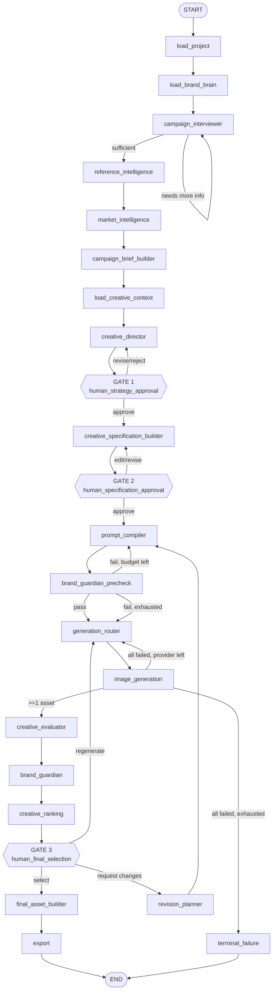

# GRAPH_SPEC.md — LangGraph orchestration contract

The graph is the application's control flow. It is a **controlled graph of
specialized nodes over one shared, typed state** — not a swarm of autonomous
agents. Every node has a narrow job, declared inputs and declared outputs.

Most nodes also write `status`; it is omitted from the table below for readability and is present in `NODE_CONTRACTS`.

Canonical state: `backend/app/graph/state.py` (`CampaignState`).
Machine-readable contracts: `backend/app/graph/contracts.py` (`NODE_CONTRACTS`).
This document explains them; those files enforce them.

---

## 1. Topology

Diamond nodes are `interrupt()` points. Loop edges are guarded by a budget — `interview_turn_count` for the interview
loop, `iteration_count` for revisions, deliberately separate so a long
interview cannot consume the ability to revise; on exhaustion the graph routes to the
nearest human gate with an explanation rather than looping or dying.

---

## 2. Node contracts

`reads` and `writes` are `CampaignState` field names. A node returns a partial
dict containing **only** its declared `writes`; `tests/test_node_contracts.py`
enforces this.

| # | Node | Reads | Writes | Interrupts | On failure |
|---|------|-------|--------|-----------|------------|
| 1 | `load_project` | `project_id`, `user_id` | `organization`, `project`, `user` | no | fatal — cannot proceed without scope |
| 2 | `load_brand_brain` | `campaign_id`, `campaign_inputs`, `project` | `brand`, `brand_assets`, `brand_knowledge`, `errors` | no | degrade — continue with `brand` only, warn |
| 3 | `campaign_interviewer` | `brand`, `campaign_inputs`, `conversation`, `interview_turn_count` | `campaign_inputs`, `conversation`, `interview_complete`, `interview_turn_count`, `pending_questions` | **yes** (per turn) | retry once, then ask the human directly |
| 4 | `reference_intelligence` | `brand`, `references` | `aggregate_style`, `creative_preferences`, `errors`, `reference_analysis` | no | degrade — skip, mark unanalysed |
| 5 | `market_intelligence` | `brand`, `campaign_inputs` | `errors`, `market_context`, `regional_context` | no | degrade — brief notes context unavailable |
| 6 | `campaign_brief_builder` | `aggregate_style`, `brand`, `brand_knowledge`, `campaign_inputs`, `market_context`, `regional_context` | `campaign_brief` | no | retry once, then fatal |
| 6b | `load_creative_context` | `campaign_id` | `creative_context`, `errors` | no | degrade — the director proceeds on brand alone |
| 7 | `creative_director` | `creative_context`, `creative_revision`, `user_feedback` | `direction_set` | no | retry once, then fatal |
| 8 | `human_strategy_approval` | `direction_set` | `approval_states`, `creative_revision`, `pending_gate`, `selected_direction`, `user_feedback` | **yes** | n/a — waits indefinitely |
| 8b | `creative_specification_builder` | `creative_context`, `creative_specification`, `selected_direction` | `creative_specification` | no | retry once, then fatal |
| 9 | `prompt_compiler` | `approval_states`, `brand`, `campaign_brief`, `creative_specification`, `guardian_precheck`, `revision_delta`, `selected_direction` | `canonical_prompt`, `model_prompts` | no | retry once, then fatal |
| 10 | `brand_guardian_precheck` | `brand`, `creative_specification`, `model_prompts` | `errors`, `guardian_precheck`, `precheck_attempts` | no | degrade — pass through with a warning |
| 11 | `human_specification_approval` | `creative_specification`, `guardian_precheck`, `model_prompts` | `approval_states`, `pending_gate`, `user_feedback` | **yes** | n/a |
| 12 | `generation_router` | `generation_jobs`, `model_prompts`, `providers_attempted` | `generation_jobs`, `providers_attempted` | no | fatal if no provider is configured at all |
| 13 | `image_generation` | `generation_jobs` | `errors`, `generated_assets`, `generation_jobs` | no | per-job; partial success is success |
| 14 | `creative_evaluator` | `brand`, `campaign_brief`, `creative_specification`, `generated_assets` | `errors`, `evaluation_results` | no | degrade — unscored assets marked, human still chooses |
| 15 | `brand_guardian` | `brand`, `creative_specification`, `generated_assets`, `regional_context` | `brand_guardian_results`, `errors` | no | degrade — verdict `UNKNOWN`, surfaced in UI |
| 16 | `creative_ranking` | `brand_guardian_results`, `evaluation_results`, `generated_assets` | `asset_recommendation`, `errors`, `ranked_assets` | no | fall back to generation order |
| 17 | `human_final_selection` | `brand_guardian_results`, `evaluation_results`, `ranked_assets` | `approval_states`, `pending_gate`, `selected_asset`, `user_feedback` | **yes** | n/a |
| 18 | `revision_planner` | `creative_specification`, `selected_asset`, `user_feedback` | `iteration_count`, `revision_delta`, `revision_history` | no | ask the human to restate; do not guess |
| 19 | `final_asset_builder` | `brand`, `brand_assets`, `creative_specification`, `selected_asset` | `final_assets`, `final_design` | no | retry once, then fatal (deterministic — should not fail) |
| 20 | `export` | `brand_assets`, `campaign_brief`, `final_design` | `export_manifest`, `final_assets` | no | per-variant; report which succeeded |
| 21 | `terminal_failure` | `errors` | `status` | no | terminal by definition |

**Degrade** means: record the failure in `errors`, write a safe default, continue.
**Fatal** means: write `errors`, route to `terminal_failure`, persist status `FAILED`.
A degraded run is always visibly degraded in the UI — never silently.

---

## 3. Routing conditions

Named predicates live in `app/graph/routing.py`. They read state only; they
never mutate it and never call a provider.

**The creative stage runs as its own compiled graph** (`build_creative_graph`)
on a derived thread, `"{campaign_id}:creative"`. Discovery finishes and its
thread ends; creative work starts from the confirmed Campaign Specification,
which is durable in the database, not in a checkpoint. Extending the discovery
graph in place would have meant reopening every paused Milestone 3 conversation
against a new schema — the routing below therefore describes one workflow
across two compiled graphs, which is deliberate.

| From | Predicate | To |
|---|---|---|
| `campaign_interviewer` | `interview_complete` | `reference_intelligence` |
| | `not interview_complete and interview_turn_count < MAX_INTERVIEW_TURNS` | `campaign_interviewer` |
| | `interview_turn_count >= MAX_INTERVIEW_TURNS` | `campaign_brief_builder` (proceed on stated assumptions, flagged) |
| `human_strategy_approval` | a direction was selected | `creative_specification_builder` |
| | `REQUEST_REVISION` / `REJECT`, `direction_set.version < MAX_DIRECTION_VERSIONS` | `creative_director` |
| | `direction_set.version >= MAX_DIRECTION_VERSIONS` | `creative_specification_builder` (the set they have, not an unbounded spend) |
| `brand_guardian_precheck` | `verdict == PASS` | `human_specification_approval` |
| | *(the pre-check never edits prompts — it reports, and the compiler repairs)* | |
| | `verdict == NEEDS_REVISION and precheck_attempts < 2` | `prompt_compiler` |
| | otherwise | `human_specification_approval` (with warnings shown) |
| `human_specification_approval` | `decision == APPROVE` | `END` in Milestone 5; `generation_router` from Milestone 6 |
| | `decision == EDIT` | `creative_specification_builder` |
| | `decision == REQUEST_REVISION` | `creative_specification_builder` |
| `image_generation` | `any(job.status == COMPLETED)` | `creative_evaluator` |
| | `all failed and providers_remaining` | `generation_router` |
| | `all failed and not providers_remaining` | `terminal_failure` |
| `human_final_selection` | `decision == SELECT` | `final_asset_builder` |
| | `decision == REGENERATE` | `generation_router` |
| | `decision == REQUEST_CHANGES` | `revision_planner` |

---

## 4. Interrupts, threads and resume

- `thread_id` = `campaign_id`. One campaign is one durable conversation.
- A gate node calls `interrupt(payload)`; the payload is exactly what the UI
  needs to render the decision, and nothing more.
- The API resumes with `Command(resume=<typed decision>)`.
- Because the checkpointer is Postgres, a pending gate survives reload, restart
  and redeploy. The demo cannot be lost to a refresh.
- Resume is idempotent: answering an already-answered gate returns the current
  state instead of double-advancing.

---

## 5. State discipline

- Nodes return **partial** updates. They never construct a whole `CampaignState`.
- Append-only fields (`conversation`, `errors`, `revision_history`,
  `generated_assets`, `generation_jobs`) use `operator.add` reducers so
  concurrent branches merge instead of clobbering.
- Scalars are last-write-wins; only the owning node writes them (see the table).
- **A recompile never overwrites a human edit.** `prompt_compiler` reads the
  existing `creative_specification` and `approval_states`; any field a user
  edited at Gate 2 (or a prompt with `edited_by_user`) is carried forward.
- Anything a node needs must be in state or fetched via an injected provider.
  Node-to-node side channels are forbidden.
- State must stay JSON-serializable — it is checkpointed. Binary lives in
  storage; state holds keys and URLs.

---

## 6. Build order

The graph is assembled incrementally. Each stage is a runnable graph.

1. **M4** `load_project -> load_brand_brain -> campaign_interviewer -> campaign_brief_builder -> END`, with the interviewer loop and one real interrupt.
2. **M5** add `creative_director` + Gate 1.
3. **M6** add `prompt_compiler`, `generation_router`, `image_generation` (mock, then Gemini) + Gate 2.
4. **M7** add `creative_evaluator`, `brand_guardian`, `creative_ranking` + Gate 3.
5. **M8** add `revision_planner` and the loop edges.
6. **M9** add `final_asset_builder`, `export`.
7. `reference_intelligence` and `market_intelligence` slot in at M6/M7 — they are
   degrade-safe, so the graph runs correctly before they exist.

### What was actually built, and where the plan changed

The topology above is the Milestone 0 design. Three groups of nodes did **not**
become graph nodes, each for the same underlying reason — a graph exists to
carry state across a pause, and these have nothing to pause for. The decisions
are recorded as ADRs rather than left as drift:

| Planned nodes | Built as | Why |
|---|---|---|
| 12–13 `generation_router`, `image_generation` | database-backed jobs (`app/services/generation.py`) | tens of seconds of latency, partial failure as a normal outcome, per-provider retry — ADR-012 |
| 14–16 `creative_evaluator`, `brand_guardian`, `creative_ranking` | per-asset jobs and pure functions (`evaluation_stage.py`, `brand_guardian.py`, `recommendation.py`) | same job discipline; ranking is derived on read, never stored — ADR-012 |
| 18 `revision_planner` | rows with explicit states (`specification_revisions`) | four separate HTTP requests with nothing running between them — ADR-013 |
| 19–20 `final_asset_builder`, `export` | a product service (`composition_stage.py` + `renderer.py`) | millisecond deterministic Pillow work, no model call, no gate, cannot partially succeed — ADR-014 |

Nodes 1–11 and Gates 1–2 are real graph nodes and are what `NODE_CONTRACTS`
enforces. Gate 3 (`human_final_selection`) is a persisted human selection
(`creative_selections`), not an interrupt, for the ADR-013 reason.

**The graph was not redesigned to accommodate any of this.** `CampaignState`,
the checkpointer and the creative thread are exactly what Milestone 5 left.
